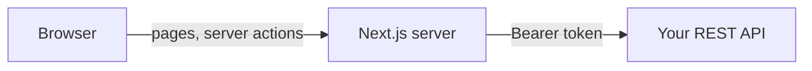
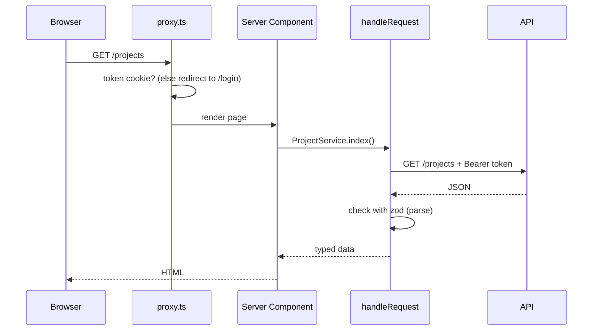
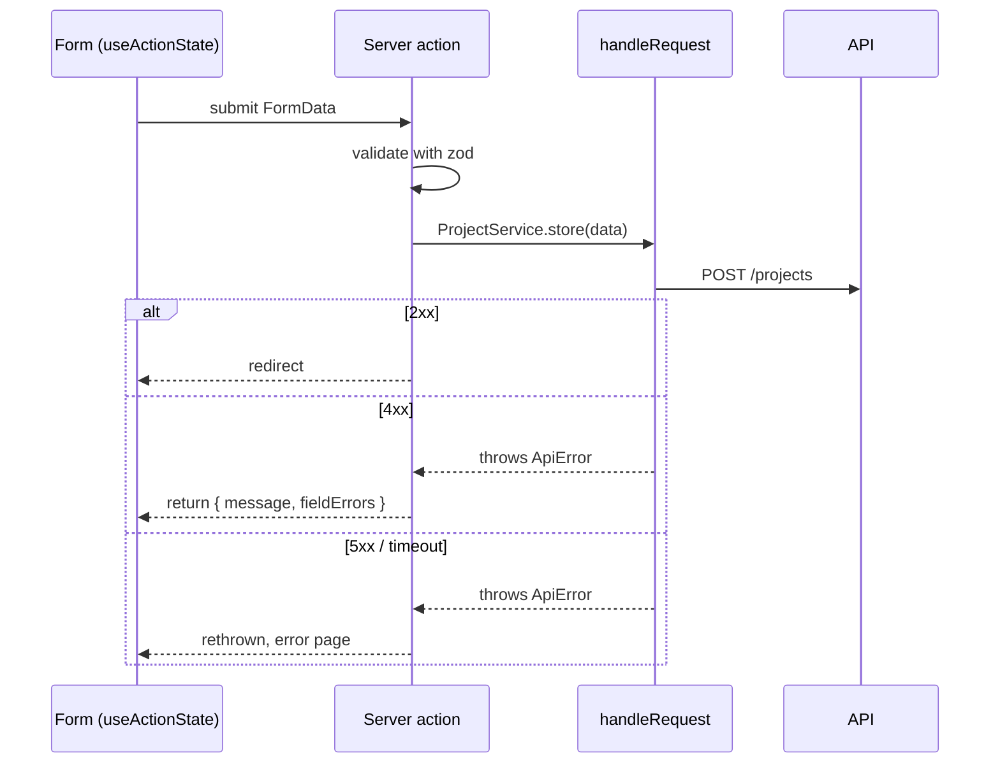

# Architecture

How the parts of the kit fit together. Each section links to the guide with the details; start here, then read the guide for the area you are changing.

## Overview

The app is a Next.js frontend for a separate REST API. Next.js renders the pages and is the only thing that talks to the API: the browser talks to Next.js, never to the API directly.

This keeps `API_URL`, the access and refresh tokens, and `ENCRYPTION_KEY` on the server. Tokens live in `httpOnly` cookies that page scripts can't read, and every API call is made by server code you control.

## Layers

| Layer        | Where                                | Job                                                                                   |
| ------------ | ------------------------------------ | ------------------------------------------------------------------------------------- |
| Proxy        | `proxy.ts`                           | Runs before every page: login redirects, token refresh, current path header           |
| Routes       | `app/`                               | Thin pages, server actions, route handlers, error and 404 pages                       |
| Views        | `views/<route>/`, `components/`      | The UI. Server Components by default; `'use client'` only where the browser is needed |
| Services     | `services/api/<resource>.service.ts` | One class per API resource, with zod schemas for its responses                        |
| Request core | `services/api/base.service.ts`       | `handleRequest`: token, timeout, errors, response checks, expired sessions            |
| Session      | `services/app/`                      | Cookies and the stored tokens                                                         |
| Client state | `lib/`                               | Redux, for UI state shared by client components only                                  |

Folders and naming: [project-structure.md](project-structure.md).

## Reading data

Pages read data in Server Components. Nothing about the API reaches the browser except the rendered result.

Details: [api-layer.md](api-layer.md#request-flow).

## Changing data

Forms call server actions. The action calls a service; validation errors come back to the form as data, other failures are thrown.

The login form shows 5xx errors as a generic message instead and logs them. The `projects` module is the complete example: [example-module.md](example-module.md).

## Sessions

1. Login: a server action posts the credentials; `saveSession` stores the tokens in `httpOnly` cookies.
2. Each page load: `proxy.ts` checks that a token cookie exists. It does not check that the token is valid; the API does that on every request.
3. Expiry: when the access cookie has expired but a refresh token is left, the proxy refreshes before the page renders. A 401 from the API triggers a refresh and one retry, or ends the session and sends the user to login, then back to the same page.
4. Logout: the API revokes the tokens, then the cookies are deleted.

Details: [auth-and-cookies.md](auth-and-cookies.md).

## Server and client code

| Runs on the server only                           | Can run in the browser             |
| ------------------------------------------------- | ---------------------------------- |
| `services/api/` (imports `server-only`)           | Components marked `'use client'`   |
| Server actions, route handlers, `proxy.ts`        | The Redux store (`lib/`)           |
| `utils/*.server.ts`, `instrumentation.ts`         | `utils/` helpers without `.server` |
| Every environment variable except `NEXT_PUBLIC_*` | `NEXT_PUBLIC_*` variables          |

Client components get API data as props from a Server Component, or change it through a server action. Redux is for UI state only, never a copy of API data: [state-management.md](state-management.md).

## Where errors end up

| What happens                                        | Where it ends up                                             |
| --------------------------------------------------- | ------------------------------------------------------------ |
| The API rejects a form (4xx)                        | Returned by the server action, shown on the form             |
| A page calls `notFound()`, or the URL doesn't exist | `app/not-found.tsx` with a 404 status                        |
| A page or action throws (API down, 5xx, timeout)    | `app/error.tsx`, with a reference ID matching the server log |
| The root layout throws                              | `app/global-error.tsx`                                       |
| The API returns an unexpected shape                 | `ApiError` with status 502, details in the server log        |
| Any server error                                    | Logged by `onRequestError` in `instrumentation.ts`           |

## Decisions

Why the kit is built this way, and how to propose a change to it, is recorded in [decisions.md](decisions.md). Read it before changing the API layer, auth, routing, state or the project structure.

Security measures and a go-live checklist: [security.md](security.md).
